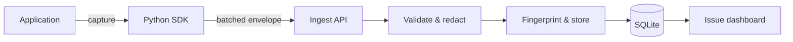

# TraceHarbor

**A production-minded error and performance monitoring demo built for developer-tooling exploration.**

TraceHarbor follows telemetry from application code to an issue dashboard: a zero-dependency Python SDK captures errors and transactions, a concurrent ingest service validates and filters untrusted payloads, and a SQLite-backed pipeline groups recurring failures into actionable issues.

It is deliberately small enough to understand end to end. The interesting work is in the boundaries: non-blocking delivery, bounded retries, idempotency, stable grouping, privacy filtering and failure-aware tests.

## What it demonstrates

- **SDK design:** exception capture, timed transactions, queueing, batching and exponential backoff with jitter
- **Ingest engineering:** authenticated envelopes, validation-before-write, payload limits and token-bucket rate limiting
- **Issue intelligence:** deterministic fingerprints group recurring failures while retaining recent event context
- **Privacy by default:** credential fields and email addresses are filtered before persistence
- **Operational thinking:** health endpoint, structured logs, WAL-mode SQLite, Docker health checks and idempotent event IDs
- **Engineering workflow:** automated tests, GitHub Actions, contribution guidelines, security notes and architecture decisions

## Architecture



The implementation uses only the Python standard library. That is an intentional constraint: it makes the core protocol, concurrency and persistence choices visible instead of hiding them behind frameworks. See [the architecture notes](docs/architecture.md) for trade-offs and a production evolution path.

## Quick start

Requires Python 3.11 or newer.

```bash
git clone https://github.com/KDDMR/traceharbor.git
cd traceharbor
python -m traceharbor.server
```

In another terminal, generate demo telemetry:

```bash
python -m examples.demo_app
```

Open [http://127.0.0.1:8080](http://127.0.0.1:8080). Re-run the demo to see recurring exceptions grouped instead of duplicated as separate issues.

### Docker

```bash
docker compose up --build
python -m examples.demo_app
```

For any shared environment, replace the local development key:

```bash
TRACEHARBOR_API_KEY="$(openssl rand -hex 24)" docker compose up --build
```

## SDK usage

```python
from traceharbor_sdk import Client

client = Client(
    "http://127.0.0.1:8080",
    "dev-key",
    "checkout-api",
    release="checkout@1.4.0",
    environment="development",
)

try:
    with client.transaction("checkout.calculate", tags={"region": "eu-central"}):
        raise ValueError("Discount code has expired")
except ValueError:
    # Failed transactions automatically capture their exception.
    pass
finally:
    client.close()
```

The client keeps normal capture calls off the network path. A background worker delivers batches on a size or time threshold. Delivery retries are bounded, and telemetry failures do not crash the monitored application.

## HTTP contract

| Method | Route | Purpose |
|---|---|---|
| `POST` | `/api/events` | Accept one event |
| `POST` | `/api/envelope` | Accept up to 100 events atomically through validation |
| `GET` | `/api/issues?project=demo-store` | List grouped issues |
| `GET` | `/api/issues/{fingerprint}?project=demo-store` | Inspect an issue and recent events |
| `GET` | `/api/metrics?project=demo-store` | Return project counters and average duration |
| `GET` | `/health` | Liveness endpoint |

Ingest requests require the API key in `X-API-Key`. See [`traceharbor/models.py`](traceharbor/models.py) for the normalized event contract.

## Verification

```bash
make check
```

The test suite covers validation, recursive redaction, grouping stability, rate limiting, SQLite idempotency, SDK batching and retries, transaction capture, authentication and a complete HTTP ingest/query round trip.

## Engineering decisions and limitations

TraceHarbor optimizes for clarity and local reproducibility, not claimed production scale. SQLite and an in-process rate limiter are appropriate for one node, but horizontal scaling would require a durable queue, shared limits and a distributed analytical store. The SDK currently uses an in-memory queue, so process crashes can lose buffered telemetry. These limitations and the next design steps are discussed in:

- [Architecture and production evolution](docs/architecture.md)
- [ADR 001: deterministic server-side issue grouping](docs/decisions/001-server-side-grouping.md)
- [Portfolio project write-up](docs/portfolio-writeup.md)

## Project structure

```text
traceharbor/          ingest service, processing, persistence and dashboard
traceharbor_sdk/      public Python SDK and HTTP transport
examples/             reproducible telemetry generator
tests/                unit and HTTP integration tests
docs/                 architecture, ADR and portfolio write-up
.github/workflows/    Python matrix tests and container build
```

## License

MIT © 2026 Kadir Demir

