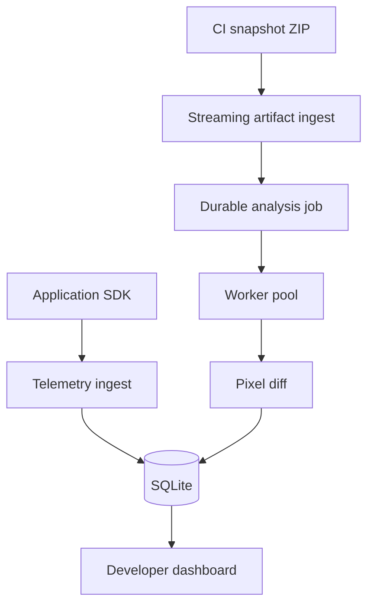

# TraceHarbor

**A production-minded observability and CI artifact-analysis demo built for developer-tooling exploration.**

TraceHarbor follows telemetry from application code to an issue dashboard and snapshot builds from CI to a visual-diff result. A zero-dependency Python SDK captures errors and transactions, while a streaming artifact endpoint feeds a durable, lease-based worker pipeline that compares PNG snapshots against a baseline.

It is deliberately small enough to understand end to end. The interesting work is in the boundaries: non-blocking delivery, streamed uploads, bounded retries, idempotency, atomic job claiming, safe ZIP handling, stable grouping, privacy filtering and failure-aware tests.

## What it demonstrates

- **SDK design:** exception capture, timed transactions, queueing, batching and exponential backoff with jitter
- **Ingest engineering:** authenticated envelopes, validation-before-write, payload limits and token-bucket rate limiting
- **Issue intelligence:** deterministic fingerprints group recurring failures while retaining recent event context
- **Privacy by default:** credential fields and email addresses are filtered before persistence
- **Operational thinking:** health endpoint, structured logs, WAL-mode SQLite, Docker health checks and idempotent event IDs
- **Artifact ingest:** chunked ZIP streaming into content-addressed storage with explicit compressed and uncompressed limits
- **Durable task pipeline:** atomic job claiming, worker leases, bounded parallelism, exponential retries and permanent-failure classification
- **Snapshot analysis:** safe archive traversal, baseline selection and pixel-level PNG comparison with added/changed/removed results
- **Engineering workflow:** automated tests, GitHub Actions, contribution guidelines, security notes and architecture decisions

## Architecture



The service and SDK intentionally use the Python standard library for HTTP, concurrency and persistence so the protocol and failure model remain visible. Pillow is used only for validated image decoding and pixel comparison. See [the architecture notes](docs/architecture.md) for trade-offs and a production evolution path.

## Quick start

Requires Python 3.11 or newer.

```bash
git clone https://github.com/KDDMR/traceharbor.git
cd traceharbor
python -m venv .venv
python -m pip install -e ".[dev]"
python -m traceharbor.server
```

In another terminal, generate demo telemetry:

```bash
python -m examples.demo_app
```

Open [http://127.0.0.1:8080](http://127.0.0.1:8080). Re-run the demo to see recurring exceptions grouped instead of duplicated as separate issues.

To exercise the CI artifact pipeline, keep the server running and execute:

```bash
python -m examples.snapshot_demo
```

The script submits a baseline and a changed snapshot build, waits for the durable jobs, and prints the added, changed and removed images. Select `snapshot-demo` in the dashboard to inspect both builds.

### Docker

```bash
docker compose up --build
python -m examples.demo_app
```

For any shared environment, replace the local development key:

```bash
TRACEHARBOR_API_KEY="$(openssl rand -hex 24)" docker compose up --build
```

## SDK usage

```python
from traceharbor_sdk import Client

client = Client(
    "http://127.0.0.1:8080",
    "dev-key",
    "checkout-api",
    release="checkout@1.4.0",
    environment="development",
)

try:
    with client.transaction("checkout.calculate", tags={"region": "eu-central"}):
        raise ValueError("Discount code has expired")
except ValueError:
    # Failed transactions automatically capture their exception.
    pass
finally:
    client.close()
```

The client keeps normal capture calls off the network path. A background worker delivers batches on a size or time threshold. Delivery retries are bounded, and telemetry failures do not crash the monitored application.

## HTTP contract

| Method | Route | Purpose |
|---|---|---|
| `POST` | `/api/events` | Accept one event |
| `POST` | `/api/envelope` | Accept up to 100 events atomically through validation |
| `GET` | `/api/issues?project=demo-store` | List grouped issues |
| `GET` | `/api/issues/{fingerprint}?project=demo-store` | Inspect an issue and recent events |
| `GET` | `/api/metrics?project=demo-store` | Return project counters and average duration |
| `POST` | `/api/artifacts/snapshots?project=demo-store` | Stream a ZIP artifact and enqueue analysis |
| `GET` | `/api/jobs/{job_id}` | Inspect queue, retry and failure state |
| `GET` | `/api/builds?project=demo-store` | List snapshot builds |
| `GET` | `/api/builds/{build_id}` | Inspect one build and its image diffs |
| `GET` | `/health` | Liveness endpoint |

Ingest requests require the API key in `X-API-Key`. Artifact submissions additionally require `Content-Type: application/zip` and an `X-Idempotency-Key`. An optional `X-Baseline-Build-Id` pins the comparison baseline; otherwise the latest completed build for the project is selected.

## Verification

```bash
make check
```

The check runs compilation, Ruff, mypy, branch coverage and the complete unit/integration suite. Tests cover validation, recursive redaction, grouping stability, rate limiting, SQLite idempotency, SDK batching and retries, streamed artifact submission, idempotency-key replay, unsafe archive rejection, worker retries and pixel-diff results.

## Engineering decisions and limitations

TraceHarbor optimizes for clarity and local reproducibility, not claimed production scale. The artifact pipeline persists jobs and leases, but its SQLite queue, local object store and thread workers remain single-node components. The default upload limit is 50 MB; the project does **not** claim demonstrated multi-GB production throughput. Horizontal scale would require S3-compatible multipart upload, Kafka or a managed queue, PostgreSQL metadata, shared rate limits and separately deployable workers. The SDK still uses an in-memory telemetry queue, so process crashes can lose buffered events. These limitations and the next design steps are discussed in:

- [Architecture and production evolution](docs/architecture.md)
- [ADR 001: deterministic server-side issue grouping](docs/decisions/001-server-side-grouping.md)
- [Portfolio project write-up](docs/portfolio-writeup.md)

## Project structure

```text
traceharbor/          ingest, durable jobs, snapshot analysis, persistence and dashboard
traceharbor_sdk/      public Python SDK and HTTP transport
examples/             reproducible telemetry and snapshot generators
tests/                unit and HTTP integration tests
docs/                 architecture, ADR and portfolio write-up
.github/workflows/    Python matrix tests and container build
```

## License

MIT © 2026 Kadir Demir

